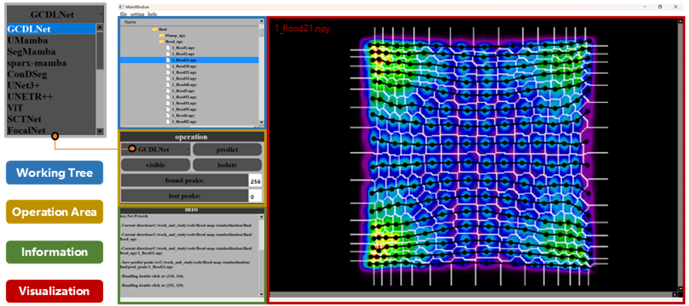

# PET LUT Calibration

A PyQt5 desktop application for calibrating PET detector LUT (look-up table) images.
Given a 256x256 LUT image, the application predicts the 256 crystal peak coordinates with a
deep regression network (GCDLNet by default), visualizes the LUT together with the predicted
peaks and the segmented crystal regions, and lets the user correct individual peaks interactively.

## Interface



The main window consists of four areas:

- **Working Tree** - browse and open `.npy` LUT images (double-click a file to load it).
- **Operation Area** - select the regression model, run `predict` / `visible` / `isolate`, and see
  the number of found / lost peaks.
- **Information** - log of the current file, executed actions and saved results.
- **Visualization** - the LUT image with the predicted peaks, watershed region boundaries and the
  cluster map (the screenshot shows the boundary view after `isolate`).

## Features

- Load a single LUT image (`.npy`, 256x256) or browse a folder from the built-in file tree.
- Predict the 256 peak coordinates with a selectable regression model (GCDLNet is loaded at startup).
- Visualization layers (cycled with the **visible** button):
  LUT image -> LUT + predicted peaks -> LUT + peaks + region boundaries -> region (cluster) map.
- **isolate** button: segment the LUT into crystal regions from the peak coordinates (watershed)
  and overlay the region boundaries.
- Interactive correction: double-click on the canvas to move the nearest peak to the clicked
  position; the corrected result is saved automatically.
- Ground-truth support: if a `peaks/` folder sits next to the `imgs/` folder, the matching
  annotation file is loaded and shown for comparison.
- Predictions are saved to a `pred_peaks/` folder next to the loaded image folder.

## Repository structure

```
pet_lut_calibration/
|-- main_window.py            # application entry point (PyQt5 main window)
|-- Ui_lut_calibration.py     # generated UI code (from lut_calibration.ui)
|-- lut_calibration.ui        # Qt Designer UI definition
|-- slot_functions.py         # UI signal handlers (import / predict / visualize / isolate)
|-- isolate.py                # peak clustering, boundary extraction and point-refinement algorithms
|-- visualization.py          # Matplotlib canvas embedded in the main window
|-- config.py                 # paths of the trained model weights
|-- meancordinate.npy         # mean peak coordinates used by the "mean" models
|-- docs/                     # images used by this README
|   `-- interface.png         # application screenshot
|-- models/                   # network definitions
|   |-- GCDLNet.py            # main model: LocalizationNetwork (default)
|   |-- ...                   # ResNet / DenseNet / UNet / LadderNet / ConvNeXt variants
|   |-- nets/                 # DeepLabV3+ backbone helpers (used by finalNet)
|   `-- utils/                # shared segmentation helpers
`-- trained_model/            # put the trained weights here (not included in this repository)
```

## Requirements

- Python 3.9+
- PyQt5, numpy, scipy, scikit-image, scikit-learn, matplotlib, torch, torchvision, timm

```
pip install -r requirements.txt
```

## Model weights

The trained weights (about 2 GB in total) are **not** part of this repository. Put them into
`trained_model/` using the file names referenced in `config.py`:

```
GCDLNet.pth            mean_model.pth
finalNet_mean.pth      stRegNet_mean.pth
denseNet121.pth        denseNet121_mean.pth
resnet18.pth           resnet34.pth
UNet.pth               UNet_mean.pth
UNet3plus.pth          UNet3plus_mean.pth
Laddernet.pth          Laddernet_mean.pth
Convnext.pth           Convnext_mean.pth
```

Only `GCDLNet.pth` and `mean_model.pth` are required for the default model; the other files are
needed only when the corresponding entry is selected in the model combo box.
File names must match the paths in `config.py` exactly (on case-sensitive file systems the case
of the file names matters).

## Data format

- LUT image: `.npy` file of shape `(256, 256)`.
- Peak annotation / prediction: `.npy` file of shape `(256, 2)`, each row is `(row, column)`.
- Folder layout expected by the application:

```
dataset/
`-- sample_01/
    |-- imgs/        # 256x256 LUT images (one .npy per sample)
    |-- peaks/       # (optional) ground-truth peaks, one .npy per sample
    `-- pred_peaks/  # predictions written by the application
```

## Usage

1. Install the dependencies: `pip install -r requirements.txt`
2. Put the trained weights into `trained_model/`.
3. Start the application from the package root:

```
python main_window.py
```

4. Typical workflow:
   - **file -> import -> file / folder** to load a `.npy` LUT image (a file in the tree on the
     left can also be opened with a double click).
   - Select a network in the combo box (**predict** always uses the selected model).
   - Click **predict** to predict the 256 peaks; the result is saved to `pred_peaks/` automatically.
   - Click **visible** to cycle through the visualization layers.
   - Click **isolate** to compute the crystal-region boundaries for the current peaks.
   - Double-click on a wrong peak to move it; the correction is saved automatically.

## Notes

- The application loads `meancordinate.npy` and creates its cache folder relative to the current
  working directory, so it should be started from the package root.
- The model files under `models/` are provided for research use; several of them are adapted from
  public open-source implementations.
